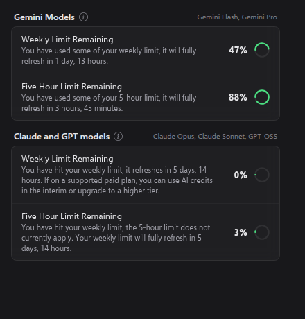
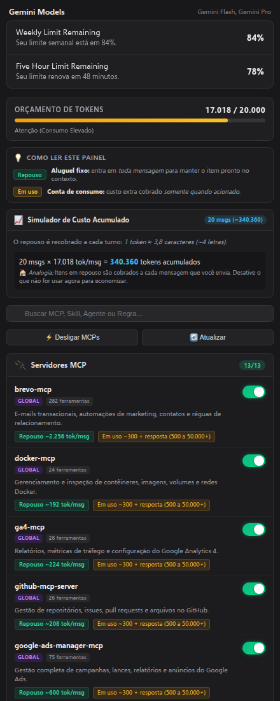
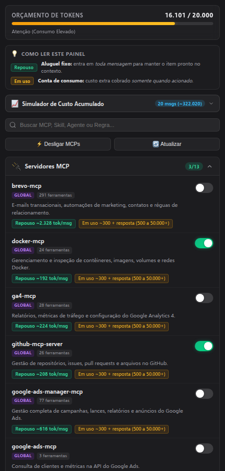
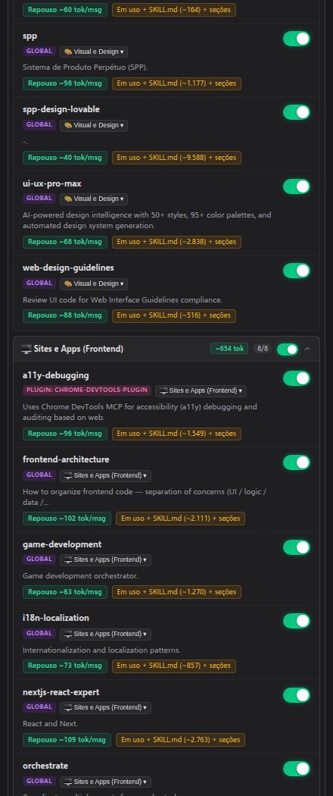
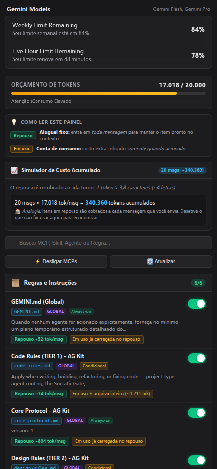

# ⚡ Gestor de Tokens IA (MCP Servers, Skills e Rules)

Painel lateral visual com alternadores táteis (*toggles* estilo macOS/iOS) para ligar e desligar **Servidores MCP**, **Skills** e **Regras (Rules)** no **Google Antigravity IDE** e no **VS Code** com apenas 1 clique.

Monitore seu **Orçamento de Tokens (Token Budget)** em tempo real e evite o alerta de *"Customization token budget exceeded. Large customizations will be truncated"*.

---

## 🎯 Por que usar o Gestor de Tokens IA?

Quando você utiliza múltiplos servidores MCP (Brevo, Google Ads, Meta Ads, WAHA, n8n) e dezenas de skills especializadas, o pre-prompt do agente pode facilmente ultrapassar **20.000 tokens por mensagem**, causando lentidão (*Time to First Token* alto) e perda de foco do modelo.

Com o **Gestor de Tokens IA**, você ganha um painel dedicado na sua barra lateral para:

* **⚡ Acesso em 1 Clique:** Ícone de raio na Activity Bar, sem precisar navegar por menus de configurações complexos.
* **📈 Cota de Modelos em Tempo Real (Antigravity):** Espelho instantâneo (latência ≤ 1s) dos limites semanais e de 5 horas para modelos Gemini e Claude/GPT via RPC nativa do Language Server.
* **📊 Orçamento de Tokens de Contexto:** Barra de progresso dinâmica que calcula o consumo total estimado de MCP, Skills, Agentes e Regras, prevenindo o truncamento de contexto.
* **🔌 Controle de Servidores MCP:** Desative ferramentas de marketing ou APIs externas quando estiver focado em código, economizando até 15.000 tokens por turno de conversa.
* **🧠 Gestão de Skills & Agentes:** Silencie pacotes de skills e agentes temporariamente de forma 100% segura e não destrutiva.
* **📜 Alternador de Regras (Rules):** Ligue ou desligue diretrizes globais e de workspace instantaneamente.
* **🚨 Botão de Pânico (⚡ Desligar MCPs):** Desative todos os servidores MCP de uma vez só com um toque quando precisar de economia máxima de tokens.

---

## 📸 Demonstração Visual (Capturas de Tela Reais)

### 1. Cota de Modelos em Tempo Real (Exclusivo Antigravity IDE)
Espelho fidedigno da tela nativa de configurações de modelos do Antigravity. Exibe os 4 indicadores oficiais (Weekly Limit e Five Hour Limit para Gemini Models e Claude and GPT models) com porcentagens dinâmicas, anéis circulares de progresso SVG e frases oficiais de renovação de limites atualizadas a cada 1 segundo.

---

### 2. Visão Geral do Painel & Medidor de Orçamento
Acompanhe o consumo total em relação ao teto de 20.000 tokens de contexto, realize buscas rápidas e acesse botões de ação imediata logo abaixo das cotas de modelos.

---

### 3. Controle de Servidores MCP
Veja todos os servidores configurados com identificação de escopo (`GLOBAL` ou `LOCAL`) e comandos, podendo alterná-los com switches táteis suaves.

---

### 4. Gestão de Skills e Agentes Especialistas
Ative apenas as skills e agentes relevantes para o momento da sua sessão de programação.

---

### 5. Alternador de Regras e Diretrizes
Controle quais regras do agente devem ser injetadas a cada requisição.

---

## 💡 Entendendo o Consumo de Tokens (v2.1.0)

Para manter o modelo de IA focado, ágil e dentro do teto de contexto sem surpresas, o Gestor de Tokens IA discrimina exatamente quanto cada item consome:

### 1. O que é um Token e a Taxa de Conversão
Um **token** é o fragmento básico de texto processado pelos modelos de linguagem (geralmente uma sílaba ou palavra curta). Na prática com linguagens naturais e códigos Markdown, adotamos o padrão de processamento de linguagem natural:
$$\text{1 token} \approx 3{,}8 \text{ caracteres (cerca de 4 letras)}$$

### 2. Repouso vs. Uso Ativo (A Analogia)
* 🏠 **Repouso (Aluguel Fixo):** Tokens injetados no pre-prompt em **todas as mensagens** que você envia para a IA. Mesmo que a ferramenta nunca seja executada, esse custo é cobrado a cada turno de conversa.
* ⚡ **Em Uso Ativo (Conta de Consumo):** Tokens adicionais consumidos **apenas quando o item é efetivamente acionado** pelo agente para ler documentações ou executar ferramentas.

### 3. Tabela Comparativa de Cálculo por Tipo

| Tipo de Customização | Custo em Repouso (por turno) | Custo em Uso Ativo (quando executado) |
| :--- | :--- | :--- |
| **MCP Lazy** (Padrão Antigravity) | `~8 tokens` por ferramenta (apenas o nome da tool) | `~300 tokens` de schema + resposta (`500` a `50.000+` tokens) |
| **MCP Eager** (Carregamento Imediato) | Schema JSON completo de cada ferramenta (`350` a `800` tokens) | Resposta pontual da execução (`500` a `5.000` tokens) |
| **Skill** | Nome + descrição no catálogo (`~40` + tamanho da descrição / 3,8) | Leitura do `SKILL.md` (`200` a `2.500` tokens) + scripts chamados |
| **Subagente** | Declaração de persona e lista de skills (`~80` + desc / 3,8) | Leitura do arquivo do agente + skills declaradas |
| **Regra Always-on** (Sempre Ativa) | Arquivo Markdown integral (`tamanho / 3,8`) | Zero custo extra (o arquivo já reside integralmente na memória) |
| **Regra Condicional** (Sob Demanda) | Apenas o resumo e gatilho (`~25` a `60` tokens) | Arquivo integral carregado somente se a condição for satisfeita |

> ℹ️ **Significado do símbolo `~` e Faixas (Mín–Máx):** Como os tokenizadores variam ligeiramente entre modelos (Gemini Flash vs Gemini Pro vs Claude), todos os números são precedidos por `~` (aproximação técnica). O uso ativo é expresso em faixa para representar respostas curtas ou volumosas.

### 4. Custo Acumulado na Conversa
O custo de repouso é **recobrado a cada nova mensagem** do chat.
* **Exemplo Real:** Se seus itens em repouso somam `220 tokens/msg`, uma conversa com **20 mensagens** acumulará:
  $$20 \text{ mensagens} \times 220 \text{ tokens} = 4.400 \text{ tokens}$$
  somente para sustentar esses itens ativos na janela de contexto.
* O simulador integrado no painel permite testar projeções para 5, 10, 20 e 50 mensagens com 1 clique.

### 5. Categorias em Acordeão e Organização Visual
Skills e Subagentes são organizados em grupos amigáveis de fácil entendimento:
* 🎨 **Visual e Design**
* 🖥️ **Sites e Apps (Frontend)**
* ⚙️ **Servidor e Dados (Backend)**
* 🧪 **Testes e Qualidade**
* 🔒 **Segurança**
* 🚀 **Publicação e Servidores**
* 📈 **Marketing e Busca (SEO)**
* 🧭 **Planejamento e Organização**
* 🤖 **Trabalho em Equipe de IA**
* 📦 **Outros**

**Hierarquia de Classificação:**
1. **Escolha Manual do Usuário (Nível 0):** Clique no chip da categoria ao lado do item para movê-lo na hora. Essa preferência é salva no IDE e prevalece sobre qualquer regra.
2. **Catálogo Embutido:** Mapeamento pré-configurado de ferramentas e skills conhecidas.
3. **Frontmatter YAML:** Campo `category: "Nome da Categoria"` no arquivo `.md`.
4. **Heurística Textual:** Detecção de termos-chave na descrição.
5. **Fallback:** `📦 Outros`.

Você também pode criar categorias próprias (ex.: `📊 Relatórios Financeiros`) diretamente pela interface através da opção **"＋ Nova categoria…"**.

---

## 🚀 Guia Rápido de Uso

1. Após instalar a extensão, localize o **ícone de Raio (⚡)** na sua barra lateral (Activity Bar).
2. Clique no ícone para abrir a aba do **Gestor de Tokens IA**.
3. **Para economizar tokens rapidamente:**
   * Clique em **`⚡ Desligar MCPs`** para silenciar todas as integrações pesadas.
   * O medidor de tokens será recalculado na hora, saindo do estado de perigo (*Orçamento Excedido*) para o estado verde (*Saudável*).
4. Quando precisar usar uma ferramenta específica (ex: rodar um workflow n8n ou criar campanha), basta expandir a seção e ligar a chave do respectivo servidor!

---

## 🔒 Segurança, Privacidade e Integridade dos seus Dados

O Gestor de Tokens IA opera de forma totalmente transparente e segura no seu ambiente:

* **100% Local e Privado:** Não coleta telemetria, não envia dados para servidores externos e não faz chamadas de rede. Todo o cálculo e gerenciamento acontecem exclusivamente na sua máquina.
* **Backup Automático Preventivo:** Toda alteração no arquivo de configurações de ferramentas (`mcp_config.json`) gera automaticamente uma cópia de segurança (`.bak`).
* **Silenciamento Não Destrutivo:** Ao desativar uma skill ou regra, a extensão adiciona a terminação `.disabled` ao arquivo ou pasta, preservando 100% do seu conteúdo e histórico intactos.
* **Sincronização em Tempo Real:** Detectores de alteração de arquivo nativos (*file watchers*) mantêm o painel sincronizado se você alterar arquivos externamente pelo terminal ou editor.

---

## 🔗 Links & Suporte Oficial

* **Repositório Oficial:** [github.com/jrdiiaas/antigravity-customizations-manager](https://github.com/jrdiiaas/antigravity-customizations-manager)
* **Reportar Problemas & Sugestões (Issues):** [github.com/jrdiiaas/antigravity-customizations-manager/issues](https://github.com/jrdiiaas/antigravity-customizations-manager/issues)
* **Guia de Contribuição & CI/CD:** [CONTRIBUTING.md](CONTRIBUTING.md)
* **Escola SINC:** [escolasinc.com.br](https://escolasinc.com.br)
* **Autor:** Alexandre Sousa Dias Junior / Escola SINC
* **Licença:** MIT (Código Aberto e Gratuito)
